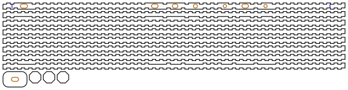
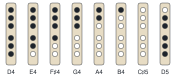

# Octagonal flute

<!-- readme-only -->
**[Read the writeup](https://gernreich.github.io/octagonal-flute/)** ·
**[Turn it in 3D](https://gernreich.github.io/octagonal-flute/#turn-it-in-3d)**

<!-- page-only **[Read the README](https://github.com/Gernreich/octagonal-flute)** -->

A six-hole transverse flute in D, the size and fingering of an Irish or simple-system
wooden flute, built in 3mm plywood as a long octagonal tube: eight strips, each the
length of the flute, finger-jointed to their neighbours down every edge. You blow
across an embouchure hole near the closed head end, as on any side-blown flute.
All holes closed, it sounds D4; opening them from the foot up gives the D major
scale to C♯5, and overblowing gives the octave above.

Output is millimetre-true — `1 user unit = 1mm` with a physical `width`/`height` — so
it prints and cuts at real size.

**It has not been cut or played yet.** The bore and the holes come from an acoustic
model whose embouchure term is not measured, so the foot is cut long, to be trimmed
to pitch. [Before you cut](#before-you-cut) says what that means for the first one.

<table>
<tr>
<td align="center"><a href="cut-files/octagonal-flute-D4-sheet1-cut-files.svg"></a></td>
</tr>
<tr>
<td align="center"><sub>the whole flute on one 582 × 152mm sheet</sub></td>
</tr>
</table>

Built for **[LaserMadeMusic](https://www.youtube.com/@LaserMadeMusic)**.

**[The rest of the build files](https://gernreich.github.io/)** — every instrument,
generator and tool, indexed.

**[Download everything as a ZIP](https://github.com/Gernreich/octagonal-flute/archive/refs/heads/main.zip)**

## The flute

| | |
|---|---|
| Key | D: D4 with every hole closed, six holes, the D major scale |
| Bore | a regular octagon 19mm across its flats inside, 299mm², the area of a 19.5mm round bore |
| Outside | 25mm across the flats; each wall 10.36mm wide outside, 7.87mm inside |
| Length | 571.9mm as cut, 546.9mm once trimmed to the model's foot |
| Parts | 12 on one sheet: eight walls, the lip plate and three cork discs |
| Joints | the walls press-fit; the lip plate glued; the cork press-fit, so it can move |

From the head end:

- **The head**: 6mm of bare tube past the cork.
- **The cork**: three octagonal discs, 9mm in all, pressed into the bore with their
  face 20mm from the embouchure's centre. They are drawn 0.12mm over the bore's size
  across the flats, the square flute's press-fit for its plug discs.
- **The embouchure**, 35mm from the head end: a slot with round ends, 7mm across and
  12mm along the flute, through the top wall and the lip plate glued over it.
- **The six holes**, on the top wall's centre line, three for each hand.
- **The foot**: open, cut 25mm longer than the model asks for.

The walls are the four-hole ocarinas' joint at 135°. Each edge is split into cells
about 6mm long, which alternate between the two walls. In its own cells a wall runs
out to the edge line; in its neighbour's it stops 2.12mm short, which is 3mm × sin
135°, the least that keeps its 3mm of ply out of the neighbour's. So every joint
closes on a line, and a small V shows outside along each seam, which the shellac
fills. Where both neighbours own the cells, a wall keeps 6.11mm of its 10.36mm width.

**The top wall keeps its whole width beside every opening.** It owns every cell of
both its edges for 3mm either side of the embouchure and each hole, so no hole sits
next to a joint.

## The embouchure

A side-blown flute speaks when a flat jet of breath, aimed across the embouchure hole,
strikes the hole's far edge and flips in and out with the air in the tube. Three
things shape how it plays, and in a flat wall of plywood each needs a decision.

**Its depth.** The hole's walls, the chimney, set how much air moves in the hole
with the jet, and so the tone: a shallow chimney is bright and easy, like a fife's;
a deep one is dark and resistant. A wooden flute's chimney is the thickness of its
wall, several millimetres. 3mm of ply alone would be nearer a fife's, so a **lip plate**, a
second ply, is glued over the top wall with the same slot through it: a 6mm chimney.

**Its size and shape.** An Irish flute's embouchure is an oval about 10 to 11mm
across and 12 to 13mm along the flute. Here the hole cannot be wider than the
top wall's inside, 7.87mm, or it would open into the joints, so it is 7mm across
and stretched to 12mm along the flute. That is about 70% of an Irish
flute's area: it should speak easily and play a little quieter.

**Its edges.** The far edge, the one the breath strikes, wants to be crisp, and the
hole's walls want an undercut, a little wider inside than out. A laser cuts square,
so **file both by hand before the lip plate goes on**, while the two plies can still
be worked from both faces. Keep the far edge sharp where it meets the lip plate's top
face, and round over the near edge, where the lower lip rests, a little.

The lip plate is 26 × 40mm, its corners rounded, wider than the 10.36mm top wall it
sits on, so the lower lip has something flat to rest on and roll the flute against.
The faces either side of the top fall away at 45° beneath it.

## Turn it in 3D

<!-- readme-only -->
The flute turns in 3D on the [published page](https://gernreich.github.io/octagonal-flute/#turn-it-in-3d),
which GitHub does not run: drag to turn it, pull it apart into its parts, or see
through the walls into the bore.

<!-- page-only <div id="turn3d"></div><script src="viewer.js"></script> -->

## The holes


| Hole | Finger | From the embouchure's centre | From the head end | Size |
|---|---|---|---|---|
| `L1` | left index | 218.8mm | 253.8mm | 7 × 11.0mm slot |
| `L2` | left middle | 252.8mm | 287.8mm | 7 × 9.2mm slot |
| `L3` | left ring | 286.8mm | 321.8mm | ø6.8mm |
| `R1` | right index | 336.0mm | 371.0mm | ø5.6mm |
| `R2` | right middle | 370.0mm | 405.0mm | 7 × 11.0mm slot |
| `R3` | right ring | 404.0mm | 439.0mm | ø5.5mm |

**Each hand's holes are 34mm apart, and the hands 49.2mm.** Left to themselves, at
one size each, the holes would fall where their notes put them: at 7mm round, 56,
17, 55, 42 and 37mm apart, the lower hand's first gap far too wide for a hand. A
smaller hole has to sit nearer the embouchure to play the same note, which is what
lets the holes close up. So in each hand one hole is as big as the wall allows, and
its place is solved; the hand's other two stand 34mm from it and their sizes are
solved. The big ones are `R2`, the lower hand's middle, and `L1`, the upper hand's
top, the two that leave their neighbours room to be smaller.

**A hole wider than the wall's inside is a slot.** No hole can be wider than 7mm,
since the wall is only 7.87mm wide inside. Above that the hole grows along the flute
instead, 7mm across and up to 12mm long, which a finger pad covers easily; the model
reads a slot as the round hole of its area. The two big holes are cut 11mm long, 1mm
short of that, so even they can be filed longer.

`R3`, the E hole, comes out small, 5.5mm, to sit within reach. Small holes play a
little veiled, so E may be the weakest note.

## Fingering



The scale is the six-hole flute's. Black is covered. Lift the fingers from the
foot up: all covered for D4, then `R3` open for E4, `R2` for F♯4, `R1` for G4,
`L3` for A4, `L2` for B4 and `L1` for C♯5. Blow a little harder, with the lips a
little closer, and the same fingerings sound the octave above; D5 is usually
fingered with `L1` open. C natural is a cross fingering, as on any six-hole flute; the model
does not work it out.

## What the model says

```sh
python3 flute_model.py
```

| Note | Hz | Off the scale, cents | Its octave, cents off 2:1 |
|---|---|---|---|
| D4 | 293.66 | 0.0 | +7.4 |
| E4 | 329.63 | 0.0 | −17.4 |
| F♯4 | 369.99 | 0.0 | −9.3 |
| G4 | 392.00 | 0.0 | −9.7 |
| A4 | 440.00 | 0.0 | −27.8 |
| B4 | 493.88 | 0.0 | −29.9 |
| C♯5 | 554.37 | 0.0 | +13.1 |

The model is a transmission-matrix one, the square flute's carried over: the bore a
lossy tube; each finger hole a Keefe tone hole in a 3mm wall; the embouchure a short
neck into open air, 6mm deep, with the cork's closed stub beside it. Its loss is
taken on the bore's hydraulic radius, which for any regular polygon is half its
flats, 9.5mm. Air is at 25°C, as breath warms it.

The first octave lands on the scale because the solver puts it there. The last
column is the useful one: it says how far each note's overblown octave lands from
a true octave. Up to 30 cents is about what a player corrects with the lips on any
simple-system flute. The cork moves it: `--cork=17` brings the cork 3mm nearer and
widens the octaves, and a cork further away narrows them.

## Before you cut

**The embouchure's end correction is not measured.** The lip covers part of the
hole, by an amount that changes with the player, and the model takes it as a quarter.
Every length rests on it: each 0.25 of `--mouth` moves the foot about 9mm and every
hole 7.8 to 8.6mm. So **the foot is cut 25mm long**. As cut, the closed note should
sound about 282Hz, D4 72 cents flat; a blue line across the top wall near the foot
marks where the model puts the end. With every hole closed, blow the cut flute and
read its pitch, measure from the embouchure's centre to the foot, then

```sh
python3 flute_model.py --heard=285 --length=537   # the pitch you heard, in Hz, and that length in mm
```

prints the `--mouth` that explains it, and the command to redraw the flute with it.
The first flute cut is the measurement.

**Trimming the foot does not tune the holes.** They move with the embouchure term
almost as far as the foot does. If the closed note needs the foot trimmed short of
the line, the holes will play sharp, and a hole cannot be made smaller. If it needs
less trimmed off than the line, they will play flat, and each can be filed longer
along the flute, which raises its note. File in small steps.

**Cut it in 3mm Baltic birch plywood**, at a 0.13mm kerf. The fingers are about
6.1mm long, with no play, so the fit comes from the kerf compensation alone. **If your
laser's kerf is not 0.13mm, redraw the sheet for its own** with `--kerf=`: a press-fit
that comes out loose wants a wider kerf, one too tight to close a narrower one.

**The walls are 571.9mm long**, and the sheet is 582 × 152mm, so the bed must be
at least 582mm long. The generator checks against a 600 × 308mm bed.

Run the engrave first, then the cuts. **Blue** engraves two lines across the top
wall: where the cork's face goes, and the model's foot. Then **orange** cuts the
embouchure and the holes, and **black** frees the parts. The top wall is drawn
outside face up, so the lines land on the outside.

## Building it

1. File the embouchure in the top wall and the lip plate as
   [The embouchure](#the-embouchure) describes, then glue the lip plate on, its slot
   over the top wall's.
2. Press the eight walls together into a tube, the top wall up. Any one wall
   comes off outward along its own face, so they can go together in any order;
   rubber bands round the tube hold it while you work round. Five of the walls are
   the same and go anywhere among themselves. The two either side of the top are cut
   back along one edge, beside the holes, where the top keeps its own: that edge goes
   against the top, and each fits only on its own side. The 3D view shows them.
3. Press the three cork discs in from the head end, one at a time, until the
   innermost one's face is under the blue line by the embouchure.
4. Seal every seam with high-cut shellac, outside and as far inside as a brush on a
   stick reaches. A flute leaks its tone out of any gap, and most of all near the
   embouchure.
5. With every hole closed, play the closed note and trim the foot toward the line,
   a millimetre or two at a time, until it sounds D4. Run `--heard` first, as above,
   to see how far that is.
6. Open each hole in turn, from the foot up, and file it longer along the flute,
   in small steps, until it plays its note.
7. Play the second octave, and move the cork a millimetre at a time to balance it
   against the first.

## Regenerating it

```sh
python3 flute_model.py                          # the design and how it plays
python3 flute_model.py --mouth=1.2              # with a different embouchure correction
python3 flute_model.py --cork=17                # with the cork elsewhere
python3 flute_model.py --heard=285 --length=537 # the correction a cut flute implies
python3 octagonal_flute.py --no-write           # the generator's checks, writing nothing
python3 octagonal_flute.py --out=cut-files      # the cut file
python3 octagonal_flute.py --kerf=0.18 --out=mine   # for a laser with a 0.18mm kerf
python3 page_assets.py                          # viewer.js, turn.html and the two plans
```

`octagonal_flute.py` draws nothing until every check passes:

- the model holds the scale;
- the bore is the octagon the model plays;
- every hole and the embouchure open into the bore;
- the top keeps both its edges beside every opening;
- ply is left between neighbouring openings;
- each hand's holes are in reach;
- a wall keeps ply between its two joints;
- the cork stands where the model puts it;
- the foot is cut long, to trim to pitch;
- the lip plate leaves the lip somewhere to rest;
- the longest part fits the bed;
- every sheet fits the bed;
- every part is on a sheet.

It imports the square flute's plates, kerf and packer from `square_flute.py`, and
the joint from the four-hole ocarinas' `polyhedron.py`, so
[square-flute](https://github.com/Gernreich/square-flute),
[four-hole-ocarinas](https://github.com/Gernreich/four-hole-ocarinas) and
[swept-curve](https://github.com/Gernreich/swept-curve) must be checked out beside
this repository.

## Files

| | |
|---|---|
| `cut-files/octagonal-flute-D4-sheet1-cut-files.svg` | the flute, every part on one sheet |
| `previews/octagonal-flute-D4-sheet1-cut-files.svg` | a display rendering of the sheet — **not** a cut file |
| `plans/octagonal-flute-top-wall.svg` · `plans/octagonal-flute-fingering.svg` | the top wall to scale, and the fingering chart — display drawings, **not** cut files |
| `viewer.js` | the 3D view, loaded by the published page |
| `turn.html` | the same 3D view on a page of its own, for framing elsewhere |
| `flute_model.py` | the acoustic model |
| `octagonal_flute.py` | the generator, its checks and the cut file |
| `page_assets.py` | builds `viewer.js`, `turn.html` and the plans |
| `README.md` · `index.html` | this writeup and its published page; the markdown is the source |
| `.repro` | the command that draws each generated file |

Released under [CC0 1.0](LICENSE).
